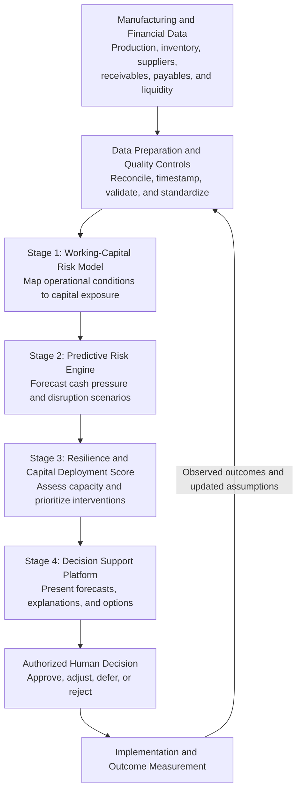
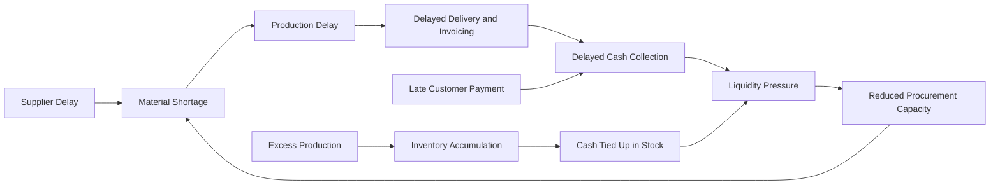
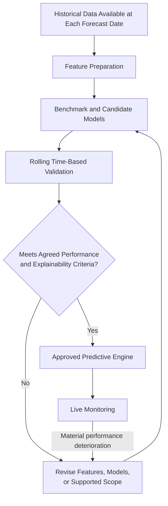
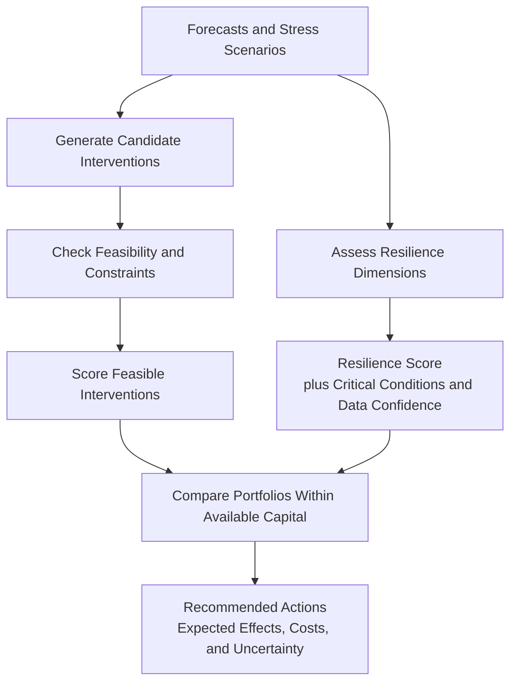
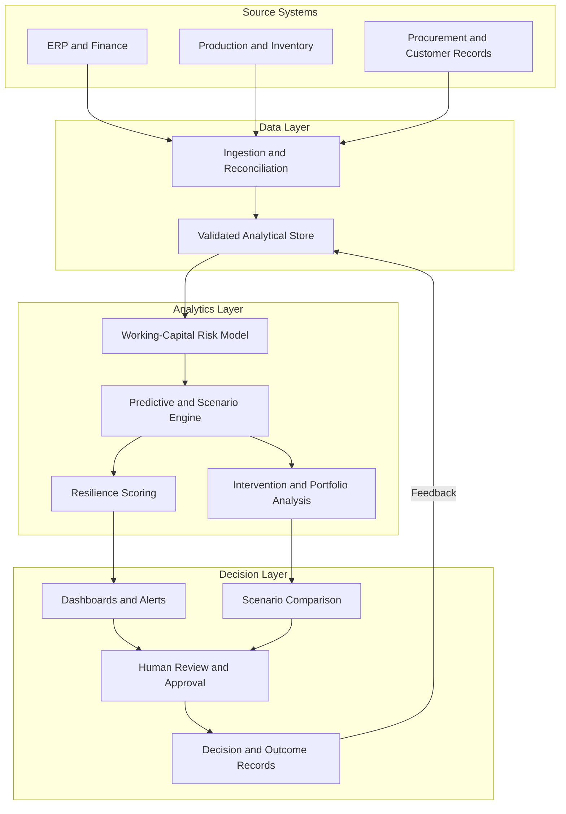
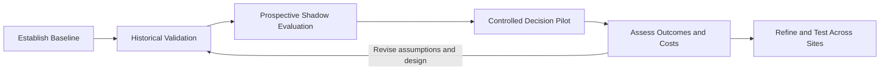

# Predictive Manufacturing Capital Resilience Framework
## Framework Methodology Draft

**Abbreviation:** PMCRF  
**Status:** Proposed methodology for development, pilot validation, and deployment

The **Predictive Manufacturing Capital Resilience Framework (PMCRF)** integrates manufacturing operations, working-capital risk modeling, predictive analytics, and capital allocation into a single decision-support process. Its purpose is to anticipate financial pressure arising from operational conditions and recommend timely, feasible interventions that support production continuity.

The framework will be developed and deployed through four stages:

1. Define the Working-Capital Risk Model.
2. Develop the Predictive Risk Engine.
3. Establish the PMCRF Resilience and Capital Deployment Score.
4. Build and Deploy the Decision Support Platform.

The methodology below describes the proposed design. Model accuracy, scoring thresholds, and business benefits must be established through validation rather than assumed.

---

## 1. Purpose, scope, and research questions

PMCRF addresses the connection between manufacturing disruptions and working-capital requirements. A delayed shipment, equipment outage, excess inventory position, or late customer payment can affect cash availability, procurement capacity, and production continuity. The framework translates these conditions into forecasts and decision options.

Its objectives are to:

- Identify operational and financial conditions that create working-capital exposure.
- Forecast the timing and magnitude of potential cash pressure.
- Assess the manufacturer’s capacity to absorb and recover from disruption.
- Prioritize capital interventions within funding and operating constraints.
- Measure whether the resulting decisions improve resilience and capital efficiency.

The initial scope is **operating working capital and short-term liquidity**. Long-term capital expenditure may be considered where it affects these outcomes, but requires a separate investment appraisal.

The pilot will investigate four principal questions:

| Question | Evaluation approach |
|---|---|
| Can operational indicators improve forecasts of working-capital pressure? | Compare integrated models with financial-only and simple forecasting baselines. |
| Can the framework provide useful warning before a shortfall? | Measure warning lead time, missed events, and false alerts. |
| Does the resilience score distinguish stronger and weaker outcomes? | Compare scores with subsequent liquidity stress and recovery performance. |
| Do recommended interventions improve decisions? | Evaluate scenarios, prospective pilot decisions, costs, and observed outcomes. |

## 2. Overall methodological architecture

The methodology follows a continuous cycle of data preparation, risk modeling, prediction, assessment, decision-making, and outcome evaluation.

**Units of analysis.** PMCRF will support assessment at manufacturer, business-unit, plant, and selected product or customer levels. The pilot will select a primary unit to avoid mixing incompatible financial and operational measures.

**Time horizons.** A rolling 13-week cash outlook is proposed for the initial pilot, supported by weekly updates. Shorter operational alerts and longer planning horizons may be added when data and decision needs justify them.

**Decision principle.** Predictions inform decisions; they do not automatically authorize payments, borrowing, procurement changes, or production adjustments.

---

## 3. Stage 1 — Define the Working-Capital Risk Model

### 3.1 Establish the operating boundary

The first stage documents the manufacturing process, financial reporting boundary, and decisions that PMCRF will support.

Activities include:

- Map procurement, production, inventory movement, delivery, invoicing, and collection.
- Identify critical materials, suppliers, customers, and production dependencies.
- Document payment obligations, credit availability, and minimum liquidity requirements.
- Agree on forecast horizons, materiality thresholds, and escalation responsibilities.
- Identify which interventions management can realistically implement.

**Deliverable:** A scope document identifying the assessment unit, supported decisions, dependencies, and constraints.

### 3.2 Develop the data model

The framework will integrate operational and financial records through consistent identifiers and timestamps.

| Data domain | Illustrative inputs | Role in PMCRF |
|---|---|---|
| Production | Planned and actual output, downtime, scrap, capacity utilization | Estimate production delays and cash effects |
| Inventory | Raw materials, work in progress, finished goods, ageing, criticality | Identify tied-up capital and stockout exposure |
| Procurement | Purchase orders, lead times, delivery performance, prices | Forecast funding needs and supply disruption |
| Receivables | Invoice dates, due dates, ageing, disputes, payment history | Forecast customer collections |
| Payables | Due dates, contractual terms, critical suppliers | Forecast payment obligations and flexibility |
| Liquidity | Unrestricted cash, committed facilities, borrowing conditions | Assess available funding capacity |
| Demand | Orders, cancellations, forecast revisions, customer concentration | Estimate inflow uncertainty and production requirements |

Each field will have a defined source, owner, update frequency, unit, and quality requirement. The methodology will distinguish information available at a forecast date from information recorded later.

**Deliverable:** A data dictionary and integration specification.

### 3.3 Define risk categories and transmission pathways

PMCRF will model how operating conditions affect working capital and liquidity.

The risk register will cover:

- **Inventory risk:** Excess, obsolete, slow-moving, or insufficient critical stock.
- **Receivables risk:** Late payment, disputes, default exposure, and customer concentration.
- **Payables risk:** Concentrated obligations, restrictive terms, and supplier sensitivity.
- **Production risk:** Downtime, quality losses, bottlenecks, and schedule instability.
- **Supply risk:** Lead-time variation, supplier concentration, and delivery failure.
- **Liquidity risk:** Mismatch between available funding and payment requirements.

A dependency map will record interactions so that the same underlying event is not counted repeatedly as independent risk.

### 3.4 Establish baseline measures

Core measures will include:

$$
\text{Operating Working Capital}
=
\text{Inventory}+\text{Trade Receivables}-\text{Trade Payables}
$$

$$
\text{Cash Conversion Cycle}
=
\text{Days Inventory Outstanding}
+
\text{Days Sales Outstanding}
-
\text{Days Payables Outstanding}
$$

Balance averages, reporting periods, and denominator conventions will be documented consistently.

Projected cash will follow:

$$
C_t=C_{t-1}+I_t-O_t+F_t
$$

Where:

- $C_t$: Closing unrestricted cash in period $t$.
- $I_t$: Cash inflows.
- $O_t$: Cash outflows.
- $F_t$: Net financing cash flows.

For scenario $s$, the cash gap relative to an approved minimum cash level is:

$$
G_{t,s}=\max(0,\ C_{\min,t}-C_{t,s})
$$

Committed undrawn facilities will be reported separately from cash, with availability conditions and draw timing explicitly modeled. This prevents facilities from being counted both as existing cash and future financing.

### 3.5 Validate the risk model

Finance, operations, procurement, and data owners will review the model against historical events and financial records.

**Stage 1 acceptance gate:**

- Key balances reconcile within agreed tolerances.
- Material risk pathways and dependencies are documented.
- Data definitions and ownership are approved.
- Baseline metrics can be reproduced.
- Known data limitations are recorded.

**Stage 1 outputs:** Risk register, dependency map, data dictionary, baseline assessment, and approved modeling specification.

---

## 4. Stage 2 — Develop the Predictive Risk Engine

### 4.1 Define prediction targets

The engine will produce forecasts that correspond to practical decisions.

| Target | Proposed output | Decision supported |
|---|---|---|
| Cash position | Weekly forecast with uncertainty intervals | Funding and payment planning |
| Liquidity breach | Probability of cash falling below the approved floor | Escalation and contingency action |
| Cash-gap magnitude | Estimated shortfall by period and scenario | Required intervention size |
| Customer collections | Expected receipt timing and payment-delay risk | Collections prioritization |
| Inventory exposure | Expected excess stock or shortage | Purchasing and production adjustments |
| Recovery | Estimated time to restore defined operating and liquidity conditions | Contingency planning |

The pilot may begin with fewer targets where data quality or sample size is limited.

### 4.2 Prepare analytical features

Features will be derived from information available at the prediction date, including:

- Trends in overdue receivables and collection timing.
- Inventory ageing, turnover, and critical-material coverage.
- Supplier lead-time variation and overdue deliveries.
- Production-plan deviations, downtime, and scrap.
- Upcoming payment concentrations.
- Order-book changes and customer concentration.
- Seasonal patterns and recent forecast errors.

Missing values, exceptional events, and reporting delays will be flagged. Training and live processing will use consistent definitions.

### 4.3 Select models progressively

Model selection will follow an evidence-based progression:

1. Establish simple benchmarks, such as historical averages, seasonal forecasts, and existing cash-planning methods.
2. Develop interpretable statistical models.
3. Evaluate more complex predictive models where data volume and performance justify them.
4. Select the approach that balances accuracy, calibration, explainability, and maintenance requirements.

Predictive associations will not be presented as proof of causation. Estimated intervention effects will use documented operational assumptions or stronger causal evidence where available.

### 4.4 Build scenario and stress-testing capability

The engine will evaluate individual and combined shocks.

| Scenario | Illustrative change | Impact evaluated |
|---|---|---|
| Collection delay | Customer receipts arrive later | Cash gap and funding duration |
| Supply disruption | Critical material arrives late | Output, delivery, and collection effects |
| Demand reduction | Orders decline or are cancelled | Inventory accumulation and reduced inflows |
| Input-cost increase | Material or energy costs rise | Payment needs and margin pressure |
| Production interruption | Capacity becomes temporarily unavailable | Recovery expenditure and delayed revenue |
| Combined stress | Several connected shocks occur | Aggregate exposure and recovery capacity |

Scenario severity, duration, dependencies, and management responses will be explicit. Stress scenarios will be distinguished from probability-based forecasts.

### 4.5 Validate predictions

Historical evaluation will use time-ordered testing and rolling forecast windows. Future information will be excluded from model inputs.

Validation will assess:

- Forecast error at each decision horizon.
- Performance against simple and existing-process baselines.
- Calibration of predicted breach probabilities.
- Coverage of forecast uncertainty intervals.
- Alert precision, missed-event rate, and warning lead time.
- Stability across plants, periods, and operating conditions.
- Sensitivity to missing or delayed data.

Error measures such as mean absolute error are preferable to percentage errors when actual cash values are near zero.

**Stage 2 acceptance gate:** The selected engine meets pre-agreed performance criteria for its supported uses, explains major drivers, and reports uncertainty and limitations.

**Stage 2 outputs:** Forecasting engine, scenario library, validation report, model documentation, and monitoring specification.

---

## 5. Stage 3 — Establish the PMCRF Resilience and Capital Deployment Score

### 5.1 Use two linked assessments

PMCRF will retain two distinct components because a manufacturer’s resilience and an intervention’s priority answer different questions.

| Component | Assessment unit | Interpretation |
|---|---|---|
| Resilience Score | Manufacturer or plant | Higher values indicate greater capacity to withstand and recover from stress |
| Capital Deployment Priority Score | Candidate intervention | Higher values indicate greater priority among feasible actions |

The platform will present both components with their supporting dimensions. A combined headline value will be considered only if validation demonstrates that it remains meaningful.

### 5.2 Construct the Resilience Score

Proposed dimensions are:

| Dimension | Assessment focus |
|---|---|
| Liquidity adequacy | Cash and reliable funding relative to stressed requirements |
| Cash-flow stability | Variability and predictability of receipts and payments |
| Inventory adaptability | Ability to release capital while preserving critical stock |
| Receivables quality | Collectability, ageing, disputes, and concentration |
| Supplier and payment resilience | Dependency, payment flexibility, and continuity exposure |
| Recovery capacity | Resources and time required to restore acceptable conditions |

Each dimension will be normalized to a common 0–100 scale, with higher values consistently representing stronger resilience.

$$
R=\sum_{j=1}^{m}w_jS_j
$$

Where:

- $R$: Resilience Score.
- $S_j$: Normalized dimension score.
- $w_j$: Dimension weight, with $\sum w_j=1$.

Initial weights will be documented as provisional, informed by expert judgment and subsequently tested against observed outcomes.

**Critical-condition rules:** A high aggregate score will not conceal a severe liquidity breach or critical supply failure. Such conditions will trigger a visible override or escalation status.

**Data confidence:** Completeness, timeliness, and reliability will be reported separately. Missing data will not be interpreted as favorable performance.

### 5.3 Identify candidate interventions

Examples include:

- Accelerating collections on material overdue invoices.
- Adjusting purchases of noncritical or excess stock.
- Funding critical materials to prevent production interruption.
- Negotiating payment changes with supplier agreement.
- Drawing available facilities when justified.
- Revising production timing.
- Increasing contingency liquidity.
- Reallocating funds across plants or business units.

Each intervention will specify its owner, cost, timing, dependencies, expected effects, and operational risks.

### 5.4 Calculate capital deployment priority

Candidate actions will first pass feasibility checks. Feasible actions will then be scored against normalized criteria.

$$
P_i=\sum_{k=1}^{n}v_kZ_{ik}
$$

Where:

- $P_i$: Priority score for intervention $i$.
- $Z_{ik}$: Intervention performance on criterion $k$.
- $v_k$: Criterion weight, with $\sum v_k=1$.

Proposed criteria include:

- Expected reduction in the cash gap or disruption exposure.
- Contribution to critical production continuity.
- Urgency and time to benefit.
- Capital efficiency.
- Implementation feasibility.
- Confidence in the estimated effect.
- Residual risk after intervention.

Correlated criteria will be reviewed to avoid double counting. Hard constraints—such as contractual obligations or minimum critical inventory—will not be reduced to optional scoring preferences.

### 5.5 Select a feasible intervention portfolio

When several actions compete for limited funds, the framework will assess combinations rather than rely solely on a ranked list.

A proposed decision objective is to minimize:

$$
\mathbb{E}[\text{Residual Disruption Loss}(x)]
+
\text{Implementation Cost}(x)
+
\lambda\,\text{Downside Risk}(x)
$$

Subject to:

- Available capital and funding conditions.
- Minimum cash requirements.
- Critical inventory and production requirements.
- Contractual payment obligations.
- Implementation capacity and timing.
- Dependencies or conflicts between interventions.

Here, $x$ represents selected actions and $\lambda$ reflects the approved sensitivity to downside risk. Financial consequences will be valued consistently, and overlapping benefits will not be counted twice.

Where benefits cannot be credibly monetized, the platform will present explicit trade-offs rather than create unsupported financial precision.

### 5.6 Calibrate and validate scoring

Validation will examine:

- Whether lower resilience scores correspond to greater subsequent stress.
- Whether classifications remain stable under reasonable weight changes.
- Whether critical conditions are consistently detected.
- Whether priority rankings change appropriately when budgets or scenarios change.
- Whether users can understand and challenge the recommendations.

**Stage 3 acceptance gate:** Scoring rules are reproducible, explainable, sensitive to material risks, and supported for pilot use.

**Stage 3 outputs:** Scoring manual, calibrated scorecard, feasibility rules, intervention library, and capital allocation methodology.

---

## 6. Stage 4 — Build and Deploy the Decision Support Platform

### 6.1 Platform architecture

### 6.2 Core user functions

The initial platform will provide:

- A rolling cash outlook with uncertainty and breach indicators.
- Resilience scores with visible contributing dimensions.
- Alerts showing likely timing, magnitude, and risk drivers.
- Scenario comparisons under different operating assumptions.
- Recommended interventions with costs, constraints, and expected effects.
- Decision records capturing approval, modification, rejection, and rationale.
- Outcome tracking against the forecast and chosen action.

Users must be able to distinguish actual records, forecasts, assumptions, and recommendations.

### 6.3 Deployment sequence

| Phase | Activity | Exit requirement |
|---|---|---|
| Prototype | Implement calculations and core interface | Outputs are reproducible and traceable |
| Historical evaluation | Replay earlier periods | Performance and limitations are documented |
| Shadow operation | Produce live outputs alongside current processes | Reliability and user usefulness are demonstrated |
| Controlled pilot | Use reviewed recommendations in selected decisions | Decisions and outcomes are recorded |
| Expansion | Add plants or manufacturers | Local data, models, and thresholds are revalidated |

A shadow phase allows prospective assessment without confusing retrospective model fit with live usefulness.

### 6.4 Operational controls

The platform will include:

- Access permissions aligned with user responsibilities.
- Data freshness and quality indicators.
- Version records for models, scores, and assumptions.
- Traceability from recommendations to source inputs.
- Approved escalation and override procedures.
- Monitoring for model deterioration and processing failures.
- A documented fallback to established planning processes.

**Stage 4 acceptance gate:** The platform operates reliably, supports authorized decisions, and produces auditable records.

**Stage 4 outputs:** Deployed pilot platform, user guidance, operating procedures, training materials, and deployment evaluation.

---

## 7. Pilot evaluation and evidence strategy

### 7.1 Select pilot participants

Participants will be selected based on data availability, operational diversity, management engagement, and access to measurable outcomes.

The preferred progression is:

1. One plant or business unit for initial feasibility.
2. Additional sites with differing operating conditions.
3. Independent manufacturers to evaluate transferability.

A successful single-site pilot will establish feasibility for that setting; broader applicability requires additional evidence.

### 7.2 Establish the evaluation protocol before deployment

The protocol will define:

- Baseline periods and comparison methods.
- Forecast horizons and event definitions.
- Primary and secondary outcome measures.
- Acceptable alert burden.
- Minimum evaluation duration and event coverage.
- Treatment of missing data and unusual conditions.
- Rules for reporting negative or inconclusive findings.

Where feasible, a staggered rollout or comparison site will help distinguish framework effects from seasonality, market conditions, and concurrent process changes.

### 7.3 Measure technical and business performance

| Evaluation area | Measures |
|---|---|
| Prediction | Cash forecast error, probability calibration, interval coverage |
| Early warning | Warning lead time, alert precision, missed-event rate |
| Working capital | Cash conversion cycle, overdue receivables, excess inventory |
| Liquidity | Cash-floor breaches, shortfall magnitude and duration |
| Operations | Working-capital-related interruption hours and critical stockouts |
| Decisions | Recommendation uptake, decision time, override reasons |
| Economics | Realized benefits, implementation costs, financing costs |
| Transferability | Performance and recalibration effort across sites |

Targets will be set after baseline assessment and before prospective evaluation.

### 7.4 Record decisions and outcomes

Every pilot recommendation will retain:

- Forecast date and information available at that time.
- Predicted risk and uncertainty.
- Recommended action and alternatives.
- Estimated cost and expected effect.
- Management decision and rationale.
- Actual implementation date.
- Observed outcome and relevant external changes.

Avoided disruption is often unobservable. Any estimate of avoided loss will therefore identify the counterfactual assumptions and uncertainty rather than report it as a directly measured saving.

---

## 8. Governance and responsibilities

| Role | Primary responsibility |
|---|---|
| Executive sponsor | Approve scope, resources, and risk tolerance |
| Finance lead | Validate cash logic, funding assumptions, and capital constraints |
| Operations lead | Validate production dependencies and intervention feasibility |
| Procurement and commercial leads | Validate supplier and customer assumptions |
| Data owner | Maintain definitions, quality, and access |
| Analytics lead | Develop, document, and monitor models |
| Independent reviewer | Challenge validation, scoring, and reported findings |
| Authorized decision-maker | Approve actions and document rationale |

Material changes to prediction targets, score weights, or decision rules will require documented review before use.

## 9. Proposed development work packages

| Work package | Principal activities | Main deliverable |
|---|---|---|
| WP1: Scope and baseline | Map decisions, processes, data, and risks | Approved scope and baseline |
| WP2: Risk model | Define measures, pathways, and cash logic | Working-capital risk specification |
| WP3: Predictive engine | Develop benchmarks, forecasts, and scenarios | Validated analytical prototype |
| WP4: Scoring and allocation | Develop dimensions, feasibility rules, and portfolio analysis | Scoring and intervention methodology |
| WP5: Platform | Integrate analytics, interface, controls, and records | Pilot-ready platform |
| WP6: Pilot and evaluation | Conduct shadow and controlled deployment | Evaluation report |
| WP7: Transferability | Test additional settings and document adaptations | Reusable deployment guidance |

Scheduling will follow a data-readiness assessment. Each work package will have named owners, acceptance criteria, dependencies, and review dates.

## 10. Expected methodological contribution

The proposed contribution of PMCRF is the integration of:

- Operational risk signals with working-capital forecasts.
- Forecast uncertainty with resilience assessment.
- Resilience assessment with constrained capital intervention choices.
- Decision records with ongoing outcome evaluation.

Whether this integration constitutes a novel research contribution will require a separate review of existing literature and systems. Its practical value will depend on demonstrated forecast performance, useful decision support, and measurable outcomes across manufacturing settings.

The completed framework package will contain the methodology, risk and data models, predictive engine, scoring manual, intervention library, decision-support platform, validation evidence, and deployment guidance.
